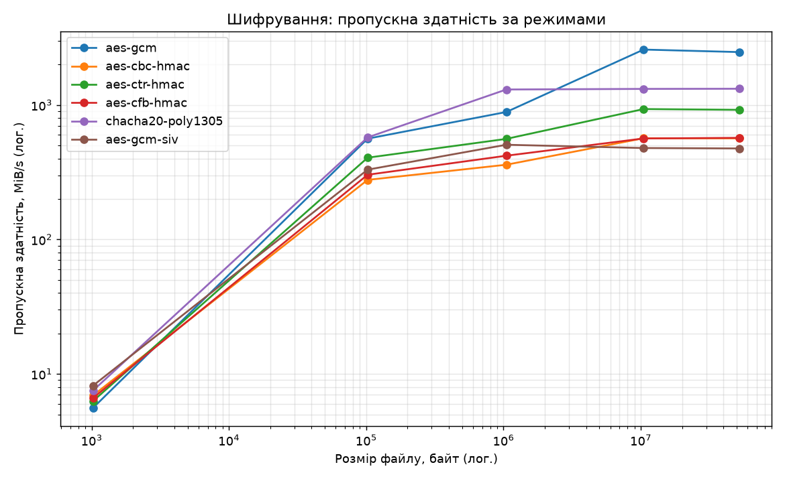
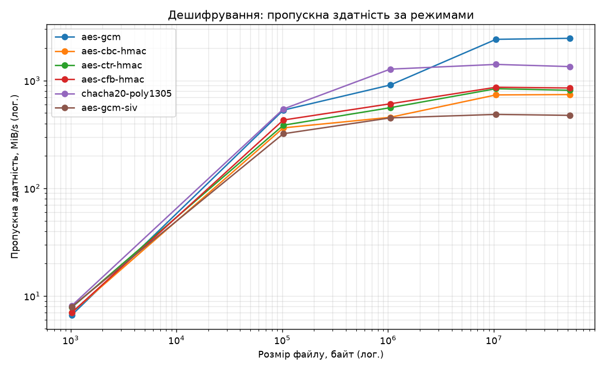
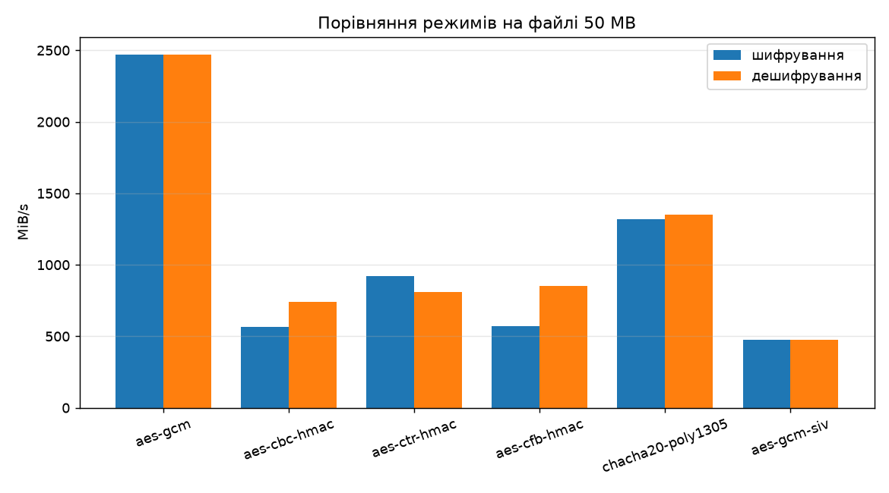
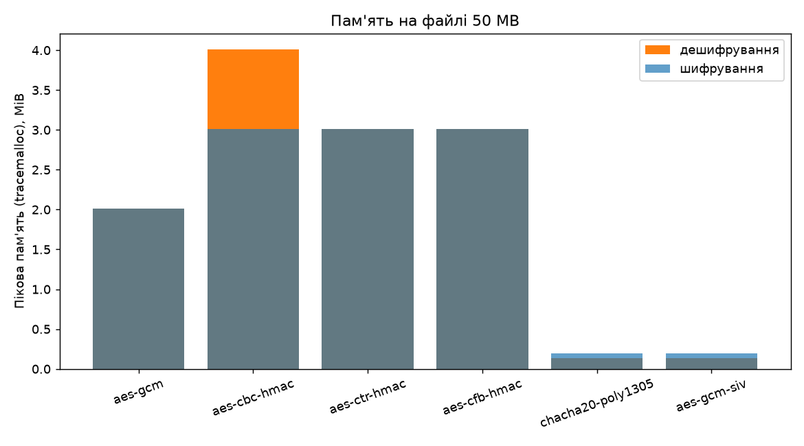
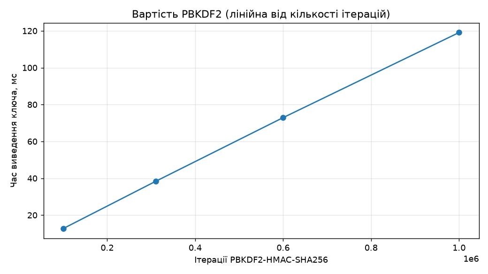

# Результати бенчмарку AES-Lab

Дата: 2026-11-24 20:22 UTC · CPU: Intel(R) Xeon(R) 6975P-C (32 логічних ядер, AES-NI: так, PCLMULQDQ: так) · Python 3.11.17 · cryptography 50.0.2 · OpenSSL 4.0.3 29 Sep 2026

Методика: файли випадкових даних; для кожного розміру і режиму — прогрів + 5 повторів шифрування й дешифрування повного файлу з атомарним записом (тимчасовий файл + os.replace); fsync вимкнено (вимірюється обчислювальна складова + запис у кеш ФС; у CLI fsync додає затримку пристрою). Час — `perf_counter` (середнє ± ст. відхилення), CPU — `process_time`, пам'ять — пік `tracemalloc` в окремому проході (Python-алокації; внутрішні буфери OpenSSL не враховуються). Ключі — 256 біт (сирий ключ без KDF, щоб виміряти саме шифр). MiB/s = розмір / середній час. Правильність кожного round-trip перевірено SHA-256.

## 1. Повна таблиця вимірів

| Розмір | Режим | Шифр., мс (±σ) | Дешифр., мс (±σ) | Шифр., MiB/s | Дешифр., MiB/s | CPU шифр./дешифр., мс | Пік пам'яті шифр./дешифр., KiB | Накладні, B (%) | OK |
|---|---|---:|---:|---:|---:|---:|---:|---:|:--:|
| 1 KB | aes-gcm | 0.17 ± 0.03 | 0.15 ± 0.02 | 5.6 | 6.7 | 0.2 / 0.1 | 1036 / 14 | 178 (17.38%) | ✅ |
| 1 KB | aes-cbc-hmac | 0.14 ± 0.01 | 0.14 ± 0.03 | 6.9 | 7.0 | 0.1 / 0.1 | 1037 / 15 | 224 (21.88%) | ✅ |
| 1 KB | aes-ctr-hmac | 0.16 ± 0.06 | 0.12 ± 0.01 | 6.3 | 7.8 | 0.1 / 0.1 | 1037 / 15 | 207 (20.21%) | ✅ |
| 1 KB | aes-cfb-hmac | 0.15 ± 0.02 | 0.14 ± 0.03 | 6.6 | 7.0 | 0.1 / 0.1 | 1037 / 15 | 207 (20.21%) | ✅ |
| 1 KB | chacha20-poly1305 | 0.13 ± 0.02 | 0.12 ± 0.02 | 7.5 | 8.1 | 0.1 / 0.1 | 76 / 14 | 190 (18.55%) | ✅ |
| 1 KB | aes-gcm-siv | 0.12 ± 0.02 | 0.12 ± 0.06 | 8.2 | 7.9 | 0.1 / 0.1 | 76 / 14 | 184 (17.97%) | ✅ |
| 100 KB | aes-gcm | 0.17 ± 0.04 | 0.18 ± 0.06 | 561.3 | 531.5 | 0.2 / 0.2 | 1135 / 212 | 178 (0.17%) | ✅ |
| 100 KB | aes-cbc-hmac | 0.35 ± 0.06 | 0.27 ± 0.04 | 277.1 | 363.8 | 0.4 / 0.3 | 1235 / 312 | 224 (0.22%) | ✅ |
| 100 KB | aes-ctr-hmac | 0.24 ± 0.02 | 0.25 ± 0.03 | 405.2 | 385.0 | 0.2 / 0.3 | 1235 / 212 | 207 (0.20%) | ✅ |
| 100 KB | aes-cfb-hmac | 0.32 ± 0.06 | 0.23 ± 0.03 | 302.6 | 430.1 | 0.3 / 0.2 | 1235 / 212 | 207 (0.20%) | ✅ |
| 100 KB | chacha20-poly1305 | 0.17 ± 0.01 | 0.18 ± 0.04 | 573.5 | 544.4 | 0.2 / 0.2 | 175 / 140 | 206 (0.20%) | ✅ |
| 100 KB | aes-gcm-siv | 0.30 ± 0.02 | 0.30 ± 0.02 | 330.2 | 320.9 | 0.3 / 0.3 | 175 / 140 | 200 (0.20%) | ✅ |
| 1 MB | aes-gcm | 1.13 ± 0.09 | 1.10 ± 0.07 | 886.0 | 908.9 | 1.1 / 1.1 | 2059 / 2060 | 178 (0.02%) | ✅ |
| 1 MB | aes-cbc-hmac | 2.78 ± 0.12 | 2.19 ± 0.01 | 359.2 | 456.0 | 2.8 / 2.2 | 3083 / 3084 | 224 (0.02%) | ✅ |
| 1 MB | aes-ctr-hmac | 1.79 ± 0.11 | 1.79 ± 0.05 | 559.1 | 559.9 | 1.8 / 1.8 | 3083 / 2060 | 207 (0.02%) | ✅ |
| 1 MB | aes-cfb-hmac | 2.39 ± 0.07 | 1.64 ± 0.03 | 419.1 | 608.6 | 2.4 / 1.6 | 3083 / 2060 | 207 (0.02%) | ✅ |
| 1 MB | chacha20-poly1305 | 0.77 ± 0.06 | 0.78 ± 0.08 | 1302.4 | 1276.4 | 0.8 / 0.8 | 203 / 140 | 430 (0.04%) | ✅ |
| 1 MB | aes-gcm-siv | 1.98 ± 0.04 | 2.22 ± 0.10 | 505.7 | 450.2 | 2.0 / 2.2 | 203 / 140 | 424 (0.04%) | ✅ |
| 10 MB | aes-gcm | 3.88 ± 0.17 | 4.14 ± 0.11 | 2580.3 | 2414.1 | 3.9 / 4.1 | 2059 / 2060 | 178 (0.00%) | ✅ |
| 10 MB | aes-cbc-hmac | 17.69 ± 0.23 | 13.58 ± 0.43 | 565.3 | 736.1 | 17.7 / 13.5 | 3083 / 4108 | 224 (0.00%) | ✅ |
| 10 MB | aes-ctr-hmac | 10.73 ± 0.51 | 11.90 ± 0.36 | 931.7 | 840.3 | 10.7 / 11.9 | 3083 / 3084 | 207 (0.00%) | ✅ |
| 10 MB | aes-cfb-hmac | 17.75 ± 0.15 | 11.53 ± 0.19 | 563.3 | 867.0 | 17.7 / 11.5 | 3083 / 3084 | 207 (0.00%) | ✅ |
| 10 MB | chacha20-poly1305 | 7.60 ± 0.62 | 7.08 ± 0.31 | 1315.6 | 1412.5 | 7.6 / 7.0 | 203 / 140 | 2734 (0.03%) | ✅ |
| 10 MB | aes-gcm-siv | 20.92 ± 1.48 | 20.61 ± 0.51 | 478.0 | 485.1 | 20.9 / 20.6 | 203 / 140 | 2728 (0.03%) | ✅ |
| 50 MB | aes-gcm | 20.24 ± 0.76 | 20.25 ± 0.71 | 2471.0 | 2468.7 | 20.2 / 20.1 | 2059 / 2060 | 178 (0.00%) | ✅ |
| 50 MB | aes-cbc-hmac | 88.57 ± 1.24 | 67.46 ± 2.27 | 564.5 | 741.1 | 88.4 / 67.4 | 3083 / 4108 | 224 (0.00%) | ✅ |
| 50 MB | aes-ctr-hmac | 54.39 ± 1.29 | 61.55 ± 1.70 | 919.3 | 812.4 | 54.3 / 61.5 | 3083 / 3084 | 207 (0.00%) | ✅ |
| 50 MB | aes-cfb-hmac | 87.83 ± 1.01 | 58.60 ± 1.52 | 569.3 | 853.3 | 87.8 / 58.4 | 3083 / 3084 | 207 (0.00%) | ✅ |
| 50 MB | chacha20-poly1305 | 37.90 ± 2.46 | 37.08 ± 3.19 | 1319.1 | 1348.4 | 37.9 / 37.0 | 203 / 140 | 12974 (0.02%) | ✅ |
| 50 MB | aes-gcm-siv | 105.35 ± 7.78 | 105.22 ± 7.13 | 474.6 | 475.2 | 105.3 / 105.2 | 203 / 140 | 12968 (0.02%) | ✅ |

## 2. Узагальнена таблиця (файл 50 MB, впорядковано за швидкодією)

| Місце | Режим | Шифр., MiB/s | Дешифр., MiB/s | Відносно найшвидшого | Тип | Цілісність | Стійкість до повтору nonce/IV | Оцінка безпеки (1–5) |
|:--:|---|---:|---:|---:|---|---|---|:--:|
| 1 | aes-gcm | 2471.0 | 2468.7 | 100% | AEAD | так (GHASH-тег) | катастрофічний (втрата автентичності, XOR текстів) | 5 |
| 2 | chacha20-poly1305 | 1319.1 | 1348.4 | 54% | AEAD (STREAM) | так (Poly1305 на сегмент) | катастрофічний (як GCM) | 5 |
| 3 | aes-ctr-hmac | 919.3 | 812.4 | 35% | EtM | так (HMAC-SHA256) | катастрофічний (повтор гами) | 4 |
| 4 | aes-cfb-hmac | 569.3 | 853.3 | 29% | EtM | так (HMAC-SHA256) | повтор IV: витік першого блоку | 3 |
| 5 | aes-cbc-hmac | 564.5 | 741.1 | 26% | EtM | так (HMAC-SHA256) | повтор IV: витік спільних префіксів | 4 |
| 6 | aes-gcm-siv | 474.6 | 475.2 | 19% | AEAD (STREAM) | так (POLYVAL-тег на сегмент) | стійкий: розкриває лише рівність сегментів | 5 |

## 3. Порівняння режимів за рівнем безпеки

| Режим | Тип | Паралелізм шифр./дешифр. | Доповнення | Проходів шифр./дешифр. | Обмеження обсягу | Стандарт | Ризики |
|---|---|---|---|---|---|---|---|
| aes-gcm | AEAD | так / так | ні | 1 / 1 | 2^32 повідомлень (випадк. nonce), 64 GiB/повід. | так (SP 800-38D) | Повтор nonce катастрофічний (витік XOR відкритих текстів і ключа H → підробка тегів); ≤2^32 повідомлень на ключ із випадковими nonce; ≤64 GiB на повідомлення; укорочений тег слабший |
| aes-cbc-hmac | EtM | ні / так | так (PKCS7/X9.23/7816) | 1 / 2 | ~2^64 блоків (birthday) — практично без обмежень | так (SP 800-38A + FIPS 198) | Без MAC або з MAC-then-Encrypt — padding oracle (Vaudenay 2002, POODLE, Lucky13); IV має бути непередбачуваним; повтор IV розкриває спільні префікси; 2 проходи при дешифруванні |
| aes-ctr-hmac | EtM | так / так | ні | 1 / 2 | 2^64 блоків на nonce | так (SP 800-38A + FIPS 198) | Повтор лічильника/nonce = повтор гами (XOR відкритих текстів); без MAC — повна пластичність (bit-flipping) |
| aes-cfb-hmac | EtM | ні / так | ні | 1 / 2 | ~2^64 блоків | так (SP 800-38A) | Шифрування послідовне (повільніше); повтор IV розкриває перший блок; без MAC — пластичність |
| chacha20-poly1305 | AEAD (STREAM) | так* / так* | ні | 1 / 1 | 2^32 сегментів × 64 KiB; nonce-префікс 56 біт | ні (RFC 8439) | Повтор nonce катастрофічний (як у GCM); не схвалений FIPS; лише 256-бітний ключ |
| aes-gcm-siv | AEAD (STREAM) | ні / так* | ні | 2 / 1 | 2^32 сегментів; ~2^48 повідомлень на ключ | ні (RFC 8452) | Двопрохідний (повільніший за GCM); потребує OpenSSL ≥ 3.2; не потоковий — лише посегментно |

\* для сегментованих режимів — паралелізм можливий між сегментами (у цій реалізації сегменти обробляються послідовно).

## 4. Вартість виведення ключа (KDF)

| KDF | Параметри | Час, мс (±σ) | Спроб підбору/с на 1 ядро |
|---|---|---:|---:|
| PBKDF2-HMAC-SHA256 | 100000 ітерацій | 12.7 ± 0.7 | 78.7 |
| PBKDF2-HMAC-SHA256 | 310000 ітерацій | 38.3 ± 0.7 | 26.1 |
| PBKDF2-HMAC-SHA256 | 600000 ітерацій | 72.9 ± 1.9 | 13.7 |
| PBKDF2-HMAC-SHA256 | 1000000 ітерацій | 119.1 ± 0.3 | 8.4 |
| scrypt | N=2^14, r=8, p=1 (~16 MiB RAM) | 29.3 ± 4.5 | 34.2 |
| scrypt | N=2^15, r=8, p=1 (~32 MiB RAM) | 66.1 ± 1.0 | 15.1 |
| scrypt | N=2^17, r=8, p=1 (~128 MiB RAM) | 279.3 ± 5.6 | 3.6 |

## 5. Висновки щодо доцільності режимів

1. **Найшвидший на великих файлах** — `aes-gcm` (2471/2469 MiB/s), найповільніший — `aes-gcm-siv` (475/475 MiB/s).
2. **Малі файли (1 KB)**: час визначається фіксованими витратами (відкриття файлів, заголовок, атомарне перейменування, HKDF), тому різниця між режимами мізерна (≈0.12–0.17 мс); накладні витрати розміру відносно великі (до 22%).
3. **AES-GCM** — рекомендований режим за замовчуванням: AEAD за 1 прохід, апаратне прискорення AES-NI+PCLMULQDQ, стандарт NIST. Обов'язкові умови: унікальний nonce (контролюється лічильником і кешем у keystore), ліміт 2^32 шифрувань на ключ, тег 128 біт.
4. **AES-CBC + HMAC-SHA256** — безпечний за схеми Encrypt-then-MAC, але повільніший: шифрування CBC не паралелізується, а дешифрування вимагає двох проходів (спершу HMAC, потім розшифрування) — 741 MiB/s проти 2469 MiB/s у GCM. Доцільний для сумісності з легасі-системами.
5. **AES-CTR/CFB + HMAC** — коректні EtM-конструкції, проте не дають переваг над GCM; CFB найменш доцільний (послідовне шифрування, перенесено в cryptography до «decrepit»).
6. **AES-GCM-SIV** — найкращий вибір, коли неможливо гарантувати унікальність nonce (розподілені системи, клонування ВМ): повтор nonce розкриває лише рівність повідомлень. Ціна — два проходи при шифруванні.
7. **ChaCha20-Poly1305** — альтернатива для платформ без AES-NI (мобільні/вбудовані), константночасова програмна реалізація; на x86 з AES-NI зазвичай поступається AES-GCM.
8. **Пам'ять**: потокові режими (GCM, *-HMAC) мають сталий пік ≈ розміру буфера (1 MiB) незалежно від розміру файлу; сегментовані AEAD — ≈ 2 сегменти (64 KiB) — придатні для файлів будь-якого розміру.
9. **KDF**: 310 000 ітерацій PBKDF2 — компроміс між затримкою розблокування (див. табл. 4) і вартістю перебору паролів; scrypt додатково стійкий до GPU/ASIC завдяки вимогам до пам'яті.

## 6. Графіки

Пікове RSS процесу бенчмарку (ru_maxrss): 174.0 MiB.
